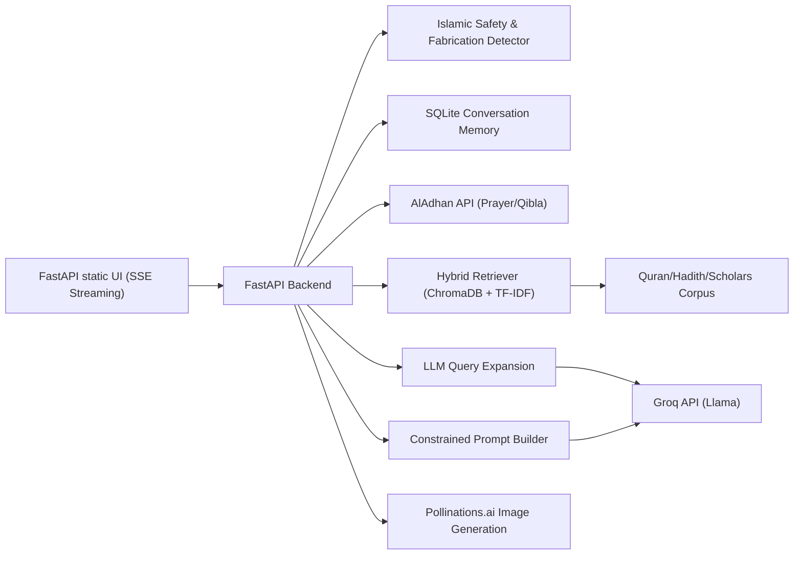

# Architecture Note

## Goal

Build an Islamic AI assistant that grounds its answers in the Quran, authentic Hadith, and scholarly consensus. It must handle denomination (Madhab) differences respectfully, prevent fabricated hadiths from being hallucinated or promoted, support UI widgets for prayer times and Qibla, and generate Islamic art.

## System Design

## Chat Flow

1. **Input Reception**: Receive user message, session ID, and Madhab preference.
2. **Safety & Moderation**: Moderate the message for general safety and explicitly detect known fabricated/weak Hadiths.
3. **Query Expansion**: Call Groq to expand the user's query into synonyms and related terms to capture diverse phrasing.
4. **Retrieval**: Retrieve the most relevant verses/hadiths from ChromaDB using semantic similarity combined with normalized TF-IDF keyword overlap against the expanded tokens.
5. **Cross-Referencing**: Find interconnected texts (e.g., related Hadiths to a retrieved Quranic verse).
6. **Context Aggregation**: Combine the retrieved corpus, cross-references, detected Duas, and recent conversation history from SQLite.
7. **Generation**: Stream a response back to the client via Server-Sent Events (SSE) while enforcing the LLM to only cite the provided context.
8. **Final Metadata**: Upon completion of the text stream, send a final metadata payload containing the full verified citations and cross-references for the UI to render.

## Hallucination & Fabrication Controls

- The model is instructed to NEVER arbitrarily quote religious texts from its training weights.
- Retrieved verses and Hadiths are injected as local variables (`Q1`, `H1`, `S1`, etc.).
- A dedicated collection of fabricated Hadiths is checked during safety evaluation. If a user asks about a known fabrication, the system catches it before the LLM generates a response and corrects the user.
- If a religious claim is not covered by the local corpus, the assistant will admit a lack of sources rather than inventing a proof text.

## Madhab Handling

The assistant adjusts its internal context based on the selected Madhab:
- `general`: General Sunni/Mainstream consensus.
- `hanafi`: Emphasizes Imam Abu Hanifa and Hanafi usul al-fiqh.
- `maliki`: Emphasizes Imam Malik and the amal of Ahl al-Madina.
- `shafii`: Emphasizes Imam Al-Shafi'i and systematic usul.
- `hanbali`: Emphasizes Imam Ahmad ibn Hanbal and textual prioritization.
- `jafari`: Emphasizes Twelver Shia jurisprudence and Imam Ja'far al-Sadiq.

In addition to prompting, the backend seamlessly adjusts the `AlAdhan` API calls (such as the Asr shadow calculation method) depending on whether `hanafi` or standard rules are selected.

## Data Storage & Deployment

- **Vector Database**: Runs a local, in-process ChromaDB instance (`./data/chromadb`).
- **Memory**: Runs a local SQLite instance (`./data/myscholar.db`).
- **Deployment**: Exposes a unified ASGI FastAPI application that serves both the API and static HTML/CSS/JS files, meaning it can be deployed easily on platforms like Render, Railway, or Heroku without complex containerization.
