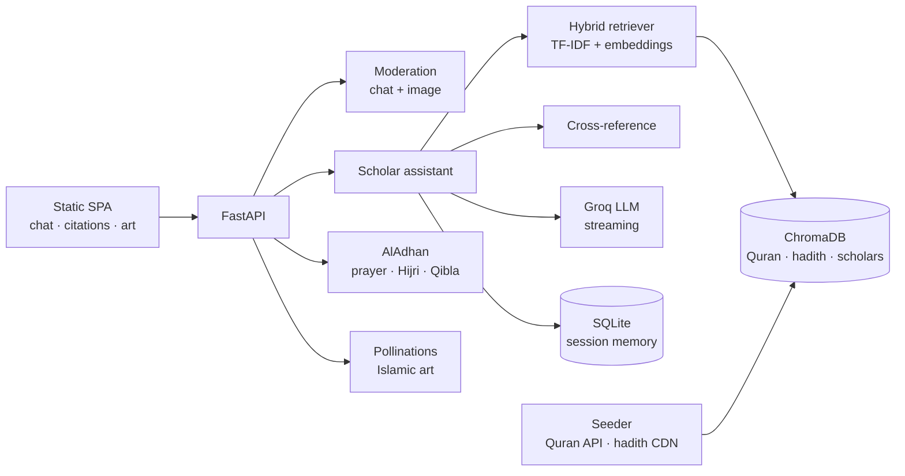

<div align="center">
  
</div>

<div align="center">

**Answers with citations, not just confidence.**

[](https://github.com/SyedShah29/myScholar/actions/workflows/ci.yml)
[](LICENSE)
[](https://www.python.org/)
[](https://fastapi.tiangolo.com/)
[](https://groq.com/)

Designed and built by **Syed Hasaan Shah**.

</div>

---

myScholar is an Islamic knowledge assistant that answers from a grounded corpus
rather than from model memory. It retrieves from the Quran, hadith collections,
and curated scholar quotes, links related passages across sources, and produces
an answer with citations, Arabic text, and audio references.

The assistant is madhab-aware, streams tokens as they arrive, and runs a
moderation layer that checks both questions and generated imagery before
anything is returned.

```text
question → safety check → hybrid retrieval → cross-reference → grounded answer
```

---

## Why myScholar

- **Retrieval-first** — answers are built from retrieved passages with explicit
  references, not free-form generation.
- **Hybrid search** — TF-IDF and dense embeddings are combined to catch both
  exact terms and paraphrase.
- **Cross-references** — Quran hits surface related hadith, and hadith hits
  surface related verses.
- **Madhab-aware** — Hanafi, Maliki, Shafi'i, Hanbali, Ja'fari, and general
  perspectives are selectable.
- **Safety by construction** — fabricated-hadith detection, blasphemy and
  extremism screening, prompt-injection checks, and image-content rules.
- **Fast and local** — Groq for generation, in-process ChromaDB for vectors,
  SQLite for conversation memory.

---

## Features

### Grounded answering
- `app/services/seeder.py` builds the corpus from the Quran API, the hadith CDN,
  scholar quotes, duas, and verified-hadith data.
- `app/services/retriever.py` performs hybrid retrieval over ChromaDB with a
  local multilingual embedding model.
- `app/services/cross_reference.py` links verses and hadith in both directions.
- `app/services/assistant.py` composes the madhab-aware prompt, calls the model,
  and returns citations with Arabic text and references.
- `app/services/dua_generator.py` builds context-aware duas with Arabic,
  transliteration, and source.

### Safety and moderation
- `app/services/moderation.py` screens chat input for scripture manipulation,
  violence, extremism, and injection attempts.
- Fabricated-hadith detection compares claims against a known-false hadith set
  and authentic entries.
- Image prompts are checked for figurative sacred imagery before generation.
- Refusals are structured and returned alongside the moderation decision.

### Experience
- `static/` — responsive single-page UI with dark/light themes, Arabic
  typography, citation cards, and audio playback.
- Server-sent events stream tokens from `POST /api/chat/stream`.
- Conversation memory is scoped per session and stored in SQLite
  (`app/services/memory.py`).
- `app/services/calendar.py` returns prayer times, Hijri date, and Qibla
  direction from the AlAdhan API.
- `app/services/image_service.py` generates Islamic art styles through
  Pollinations.

### Evaluation
- `scripts/run_evals.py` runs the bundled evaluation set against a live server.
- `eval/evaluation_dataset.jsonl` holds the question set and expected
  behaviours.

---

## Architecture



---

## Tech stack

| Layer | Technology |
| --- | --- |
| Language | Python 3.11+ |
| API | FastAPI, Pydantic v2 |
| Retrieval | ChromaDB, sentence-transformers, scikit-learn TF-IDF |
| Generation | Groq (Llama 4 Scout), OpenAI-compatible client |
| Memory | SQLite via SQLAlchemy async |
| Data | Quran API, hadith CDN, scholar corpus, duas |
| Calendar | AlAdhan API |
| Imagery | Pollinations |
| Frontend | Vanilla HTML/CSS/JS with SSE |

---

## Quick start

```bash
git clone https://github.com/SyedShah29/myScholar.git
cd myScholar

python -m venv .venv
# Windows: .venv\Scripts\Activate.ps1
source .venv/bin/activate

pip install -e .
cp .env.example .env       # add GROQ_API_KEY
uvicorn app.main:app --reload --host 127.0.0.1 --port 8000
```

Open `http://127.0.0.1:8000`.

On first start the seeder downloads and indexes the corpus; later starts reuse
the local Chroma store. Set `SEED_ON_STARTUP=false` to skip seeding, or
`ALLOW_OFFLINE_DEMO=true` to keep the interface usable without a model key.

### Configuration

| Variable | Purpose |
| --- | --- |
| `GROQ_API_KEY` | Groq API key for generation |
| `GROQ_MODEL` | Model name (default `meta-llama/llama-4-scout-17b-16e-instruct`) |
| `LOCAL_EMBEDDING_MODEL` | Multilingual sentence-transformer |
| `CHROMA_PATH` | Vector store location |
| `DATABASE_URL` | SQLite connection for session memory |
| `DEFAULT_MADHAB` | Default school of thought |
| `SEED_ON_STARTUP` | Build the corpus on boot |
| `ALLOW_OFFLINE_DEMO` | Deterministic demo answers without a key |
| `ENABLE_STREAMING`, `ENABLE_IMAGE_GENERATION` | Feature toggles |

---

## API

```text
GET  /api/health                    service and corpus status
POST /api/chat                      grounded answer
POST /api/chat/stream               SSE token stream
POST /api/images                    moderated Islamic art generation
GET  /api/calendar?lat&lon&madhab   prayer times, Hijri date, Qibla
GET  /api/search?q=                 retrieval debug view
GET  /api/sessions                  active session ids
POST /api/sessions/{id}/clear       clear session memory
```

Example:

```bash
curl -X POST http://127.0.0.1:8000/api/chat \
  -H "Content-Type: application/json" \
  -d '{"session_id":"demo","message":"What are the five pillars of Islam?","madhab":"general"}'
```

---

## Project layout

```text
app/
├── main.py            FastAPI app, routes, lifespan seeding
├── config.py          environment-backed settings
├── models.py          request/response contracts
├── services/          assistant, retrieval, moderation, calendar, images, memory
└── data/              Quran, hadith, scholar, dua, and evaluation corpora
static/                single-page frontend
scripts/               corpus builders, translation, evaluation runner
eval/                  evaluation dataset
tests/                 API and moderation tests
```

---

## Evaluation and testing

```bash
python -m pytest tests/ -v

# With the server running:
python scripts/run_evals.py --base-url http://127.0.0.1:8000
```

---

## Author

Built end-to-end by **Syed Hasaan Shah**.

---

## License

Released under the [MIT License](LICENSE).
